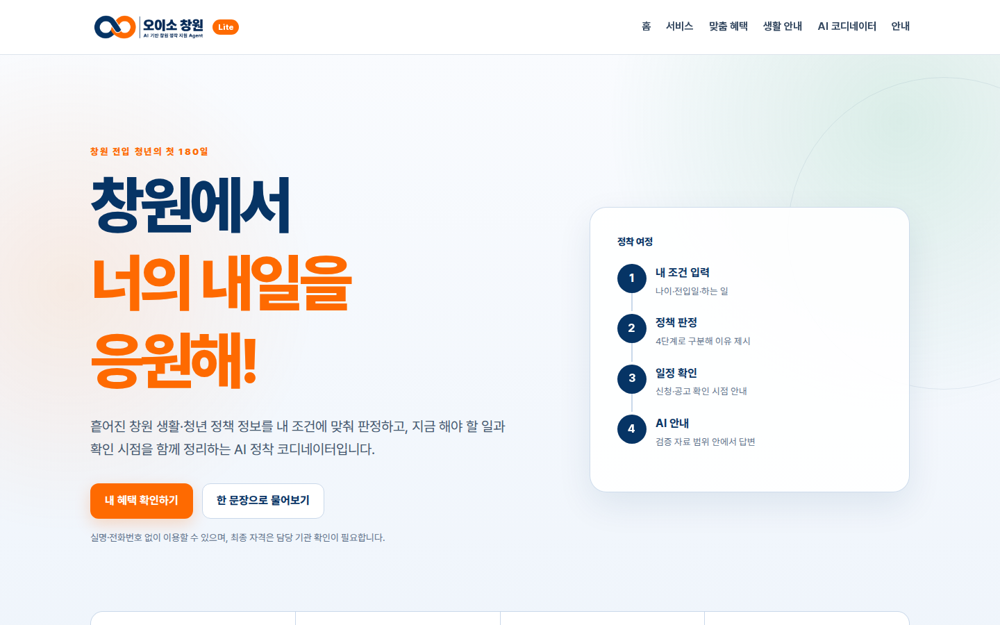
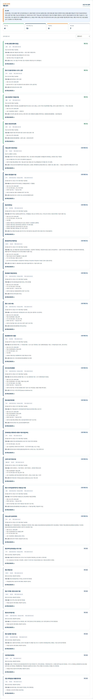
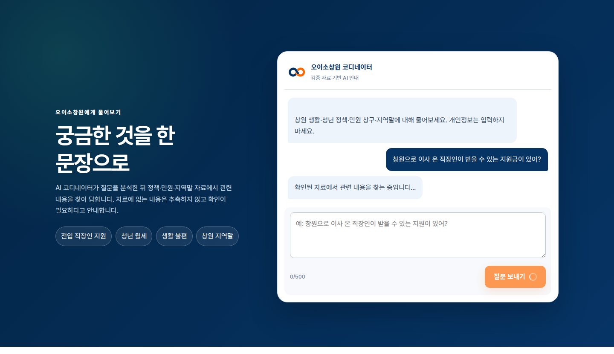
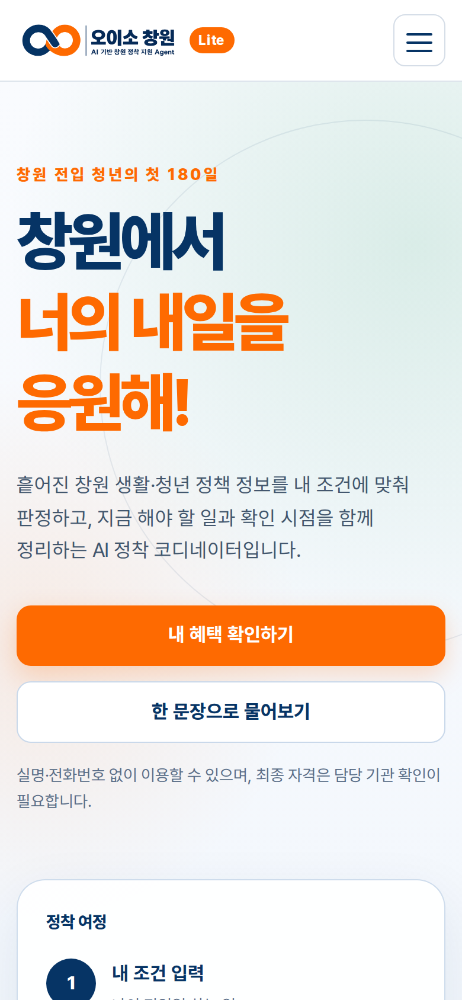
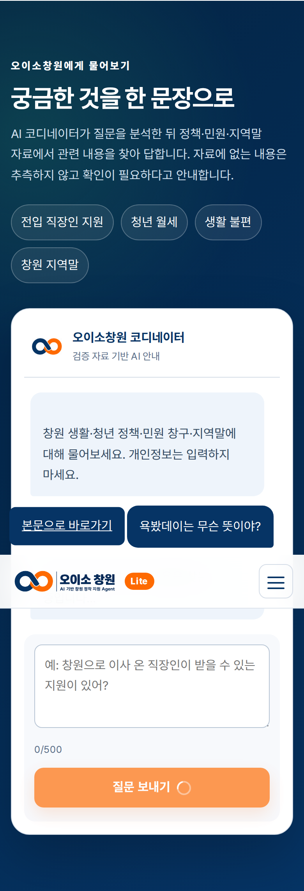
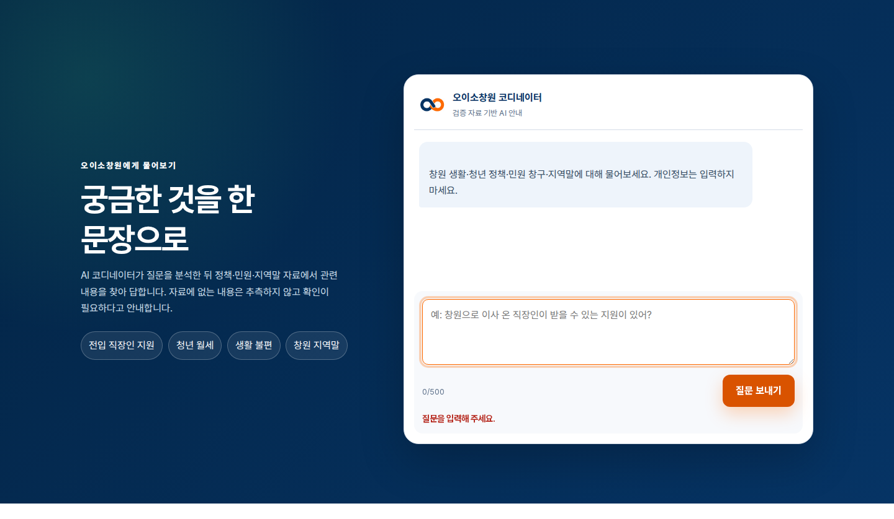

# 오이소창원 Lite

## 창원 전입 청년의 첫 180일을 돕는 AI 정착 코디네이터

- 코디세이 「AI 웹 개발: 내 아이디어를 현실로, AI 웹 서비스 빌딩」 개인 미션
- 발표자: 조준수
- 배포 URL: https://oiso-changwon-lite.vercel.app



**발표 핵심:** 기존 오이소창원의 콘셉트는 유지하고, 과제 요구 구조인 HTML/CSS/JavaScript + Vercel Python Functions로 다시 구현했다.

---

# 1. 해결하려는 문제

창원으로 이사 온 청년은 주거·취업·교통·복지·생활 정보를 여러 기관에서 따로 찾아야 한다.

- 정책을 발견해도 나이·전입일·재직 상태와 맞는지 판단하기 어렵다.
- 신청 시점과 다음 행동을 놓치기 쉽다.
- 정책 외에도 민원 창구·지역말·생활 활동 정보가 흩어져 있다.

## 타겟 사용자

- 창원 전입 또는 전입 예정 청년
- 창원에서 받을 수 있는 혜택과 생활 정보를 한곳에서 확인하려는 사용자

---

# 2. 기존 오이소창원에서 Lite로

| 구분 | 기존 오이소창원 | 오이소창원 Lite |
|---|---|---|
| 서비스 콘셉트 | 창원 전입 청년 정착 지원 | 동일 |
| 프론트엔드 | Streamlit | HTML/CSS/JavaScript |
| 백엔드 | Streamlit 내부 Python | Vercel Python Functions |
| 배포 | Streamlit Community Cloud | Vercel |
| AI | 기존 Agent 설정 | Gemini 우선, OpenAI 대체 |

- 팀 프로젝트의 목적·브랜드·검증 데이터는 유지했다.
- 개인 미션에서는 프론트·백엔드를 분리하고 Vercel 구조로 재구현했다.
- 이메일 알림·영구 저장·캘린더 파일은 Lite 범위에서 제외했다.

---

# 3. 서비스 구성

한 개의 반응형 페이지에 6개 메뉴·섹션을 구성했다.

1. 홈
2. 서비스 소개
3. 맞춤 혜택
4. 생활 안내
5. AI 코디네이터
6. 안내

## 사용자 흐름

```text
내 조건 입력 → 정책 판정 → 일정·다음 행동 → AI 안내
```

- 정책 자격은 규칙으로 비교한다.
- AI는 검증된 자료 범위 안에서 설명한다.
- 최종 자격과 최신 모집 일정은 공식 기관에서 다시 확인하도록 안내한다.

---

# 4. 핵심 기능 A — 맞춤 혜택 판정

사용자가 6개 조건을 입력하면 정책 24건을 판정한다.

- 만 나이
- 창원 전입일
- 현재 하는 일
- 창원 사업장 재직 여부
- 전입 전 타지역 거주 기간
- 차량 보유 여부

## 4단계 결과

- 해당 가능
- 조건부 해당 가능
- 직접 확인
- 해당 없음



---

# 5. 핵심 기능 B — AI 코디네이터

사용자가 자연어로 질문하면 관련 자료를 검색한 뒤 답변한다.

- 청년 정책
- 생활 불편·민원 창구
- 창원 지역말
- 생활·문화 활동

## 답변 원칙

- 자료에 없는 사실·금액·날짜·연락처를 만들지 않는다.
- 정책 자격을 확정하지 않고 확인 조건을 설명한다.
- 자료가 없으면 추측하지 않고 질문을 구체화하도록 안내한다.
- 화재·사고·위기 표현은 AI 호출보다 109·112·119 안내를 우선한다.



---

# 6. 웹이 작동하는 구조

```text
사용자 입력
  ↓
HTML 폼·텍스트 입력
  ↓
JavaScript 입력 검증
  ↓
fetch('/api/recommend') 또는 fetch('/api/chat')
  ↓
Vercel Python Function
  ├─ 정책 규칙 판정
  ├─ 검증 JSON 검색
  └─ Gemini 우선 / OpenAI 대체 호출
  ↓
JSON 응답
  ↓
JavaScript가 결과를 화면에 표시
```

## 역할 구분

- HTML: 화면 구조
- CSS: 디자인·반응형
- JavaScript: 입력 검증·API 요청·결과 표시
- Python: 정책 판정·자료 검색·AI 호출

---

# 7. 오류와 개선 과정

| 오류 | 원인 | 개선 |
|---|---|---|
| Vercel 404·빈 화면 | Python 프리셋, `main` 브랜치 덮어쓰기 | Framework `Other`, 과제 브랜치 Production 지정 |
| 키 미설정 표시 | 변수명 불일치, Development에만 적용 | 변수명 정리, 전체 환경 적용 |
| Gemini 요청 헤더 오류 | 여러 환경 변수 문장을 한 값에 붙여넣음 | 비밀값 정규화·해당 키 한 줄 추출 |
| OpenAI 호출 실패 | API 사용 한도·크레딧 제한 | Gemini 우선, OpenAI 대체 구조 |
| 원인 파악 어려움 | 모든 오류를 같은 메시지로 표시 | 오류 유형별 안내·서버 로그 분리 |
| 진단 중 보안 위험 | 상세 오류에 비밀값 포함 가능성 | 임시 진단 제거·키 패턴 자동 검사 |

## 핵심 학습

코드를 생성하는 것보다 **배포 환경·브랜치·환경 변수·외부 API 오류를 분리해 확인하는 과정**이 중요했다.

---

# 8. 테스트 결과

## 최종 검증

- 운영 URL: 정상 응답
- 실행 테스트: **17개 중 17개 통과**
- 맞춤 혜택 API: **3회 연속 성공**
- 정책 판정: **24건 정상 처리**
- 비밀값 노출 검사: **0건**

## 기준 프로필 판정

| 판정 | 개수 |
|---|---:|
| 해당 가능 | 4 |
| 조건부 해당 가능 | 13 |
| 직접 확인 | 0 |
| 해당 없음 | 7 |

- 빈 입력·500자 초과·필수값 누락·나이 오류 정상 차단
- 화재 질문에 112·119 고정 안내

---

# 9. 반응형·증빙

- 데스크톱과 모바일 화면에서 레이아웃을 확인했다.
- 모바일에서는 메뉴를 접고 폼과 AI 결과를 1열로 표시한다.
- AI 작동 화면, 정책 판정 화면, 빈 입력 오류 화면을 증빙으로 저장했다.

<div style="display:flex;gap:20px;align-items:flex-start;">
  
  
  
</div>

---

# 10. 결론과 개선 방향

## 결과

- 기존 아이디어를 과제 기술 구조에 맞게 재구현했다.
- 실제 URL 배포, AI 연동, 오류 처리, 보안, 반복 테스트까지 완료했다.
- 팀 프로젝트 자산과 개인 미션 구현 범위를 문서에서 구분했다.

## 남은 개선점

1. 정책 데이터 정기 갱신
2. 민원·지역말 검색 동의어 확대
3. 외부 AI 장애 시 규칙 기반 답변 강화
4. 실제 사용자 3~5명 모바일 사용성 테스트
5. 노출 의심 기존 API 키 폐기·재발급

# 오이소창원 Lite

https://oiso-changwon-lite.vercel.app
